<div align="center">
  

  <p><code>A Java Swing desktop course storefront with admin and user flows, built as an AIUB course project.</code></p>

  <p>
    <a href="https://github.com/Saji-d/codingvibes-java-gui"></a>
    
    <a href="LICENSE"></a>
  </p>
  <p>
    
    
    
  </p>

  <p>
    <a href="#-overview">Overview</a> ·
    <a href="#-highlights">Highlights</a> ·
    <a href="#-preview">Preview</a> ·
    <a href="#-architecture">Architecture</a> ·
    <a href="#-tech-stack">Tech Stack</a> ·
    <a href="#-getting-started">Getting Started</a> ·
    <a href="#-project-structure">Structure</a> ·
    <a href="#-roadmap">Roadmap</a> ·
    <a href="#-author">Author</a>
  </p>
</div>


## ◈ Overview

CodingVibes is a desktop storefront for programming courses, written in plain Java Swing. A visitor picks the **Admin** or **User** entry on the landing page, signs up or logs in, browses language courses, fills a cart and walks through a payment screen. Admins get a separate dashboard to add and remove users and add developers.

It is an **academic project** made for a university course to practise object-oriented design and event-driven GUI programming. Everything commercial is a simulation: there is no real payment, no database and no network access. Accounts live in plain-text files, so it is not a model of secure authentication.


## ◈ Highlights

<table>
  <tr>
    <td width="33%" valign="top"><b>Two entry roles</b><br>Landing page splits into Admin and User login, plus a user sign-up form.</td>
    <td width="33%" valign="top"><b>Course catalogue</b><br>Two catalogue pages and a detail window per language (Java, Python, C++, Kotlin, Go and more).</td>
    <td width="33%" valign="top"><b>Shopping cart</b><br>Add and remove courses; the cart is held in memory for the session.</td>
  </tr>
  <tr>
    <td valign="top"><b>Simulated payments</b><br>Card, bKash, Nagad, Rocket and generic mobile payment screens ending in a confirmation page.</td>
    <td valign="top"><b>Admin dashboard</b><br>Add users, remove users, view registered users and add developers.</td>
    <td valign="top"><b>Content pages</b><br>About us, vision and mission, team, blog, reviews, contact and special services.</td>
  </tr>
  <tr>
    <td valign="top"><b>Flat-file storage</b><br>User and admin records are appended to and read from <code>Data/*.txt</code> with <code>java.io</code>.</td>
    <td valign="top"><b>Plain Swing, no dependencies</b><br>Only the JDK is needed: Swing, AWT and the standard library.</td>
    <td valign="top"><b>About 7.8k lines</b><br>One class per screen across 54 Java files, split into <code>main</code> and <code>interfaces</code>.</td>
  </tr>
</table>


## ◈ Preview

<div align="center">
  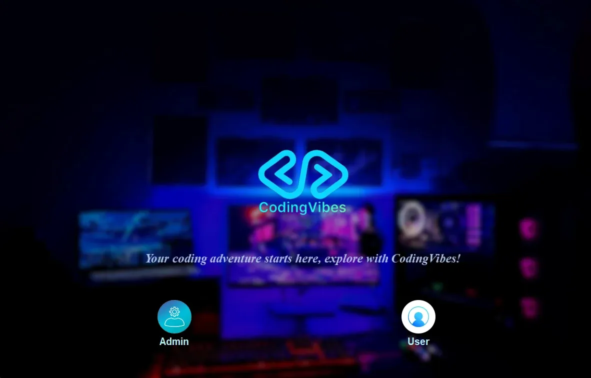
</div>

<br>

<table>
  <tr>
    <td width="50%">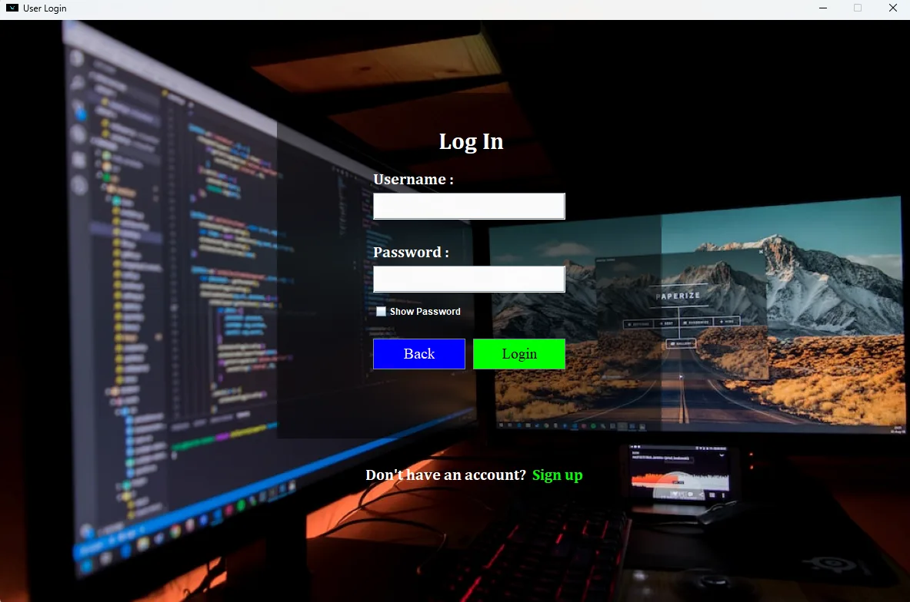<br><sub><b>User login</b></sub></td>
    <td width="50%">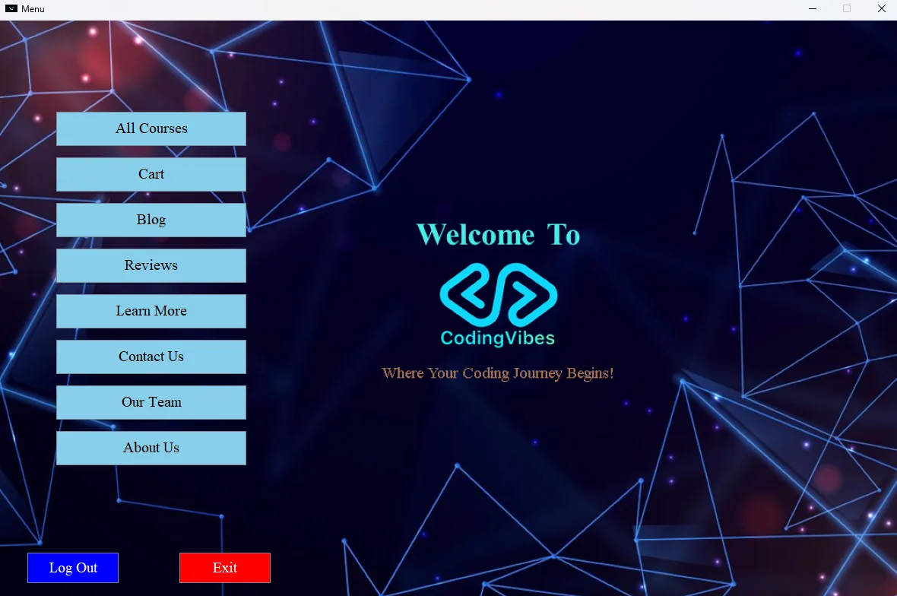<br><sub><b>Main menu</b></sub></td>
  </tr>
  <tr>
    <td>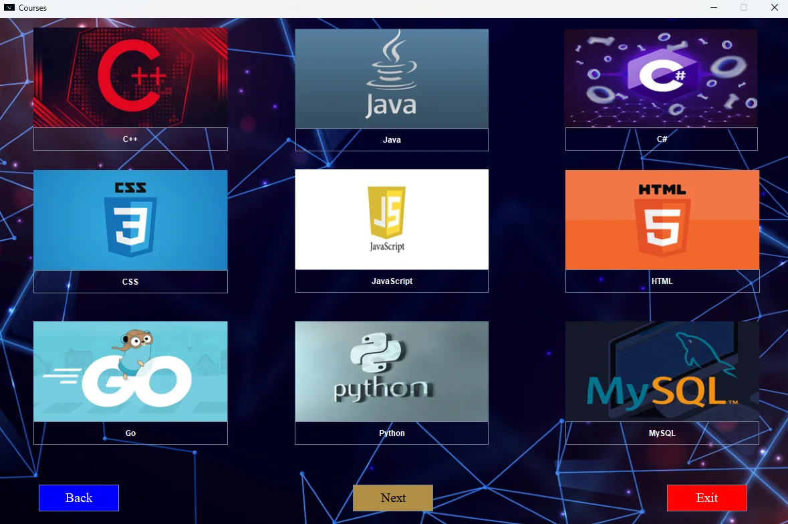<br><sub><b>Course catalogue</b></sub></td>
    <td>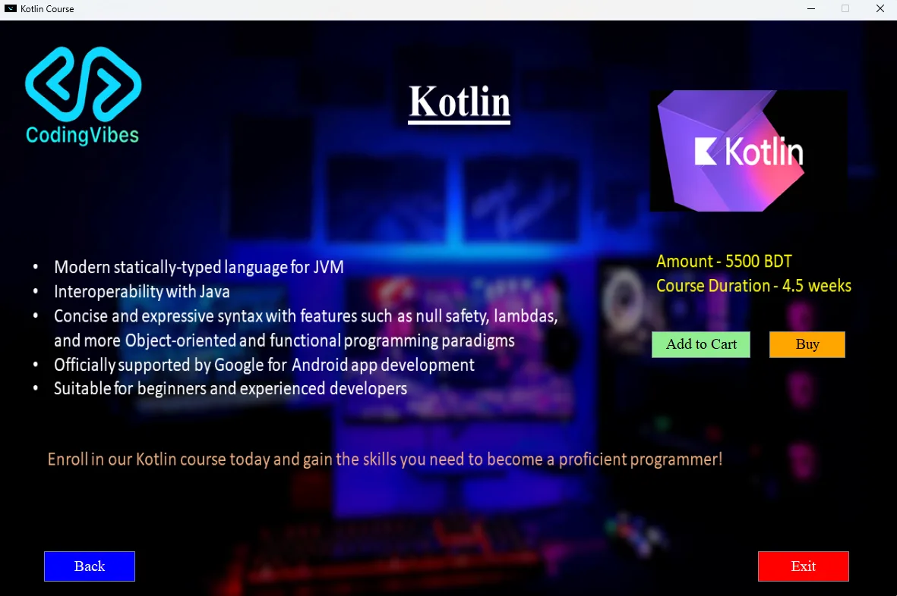<br><sub><b>Course details</b></sub></td>
  </tr>
  <tr>
    <td>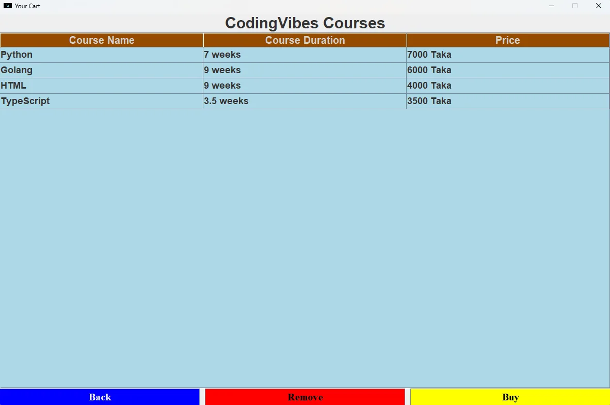<br><sub><b>Shopping cart</b></sub></td>
    <td>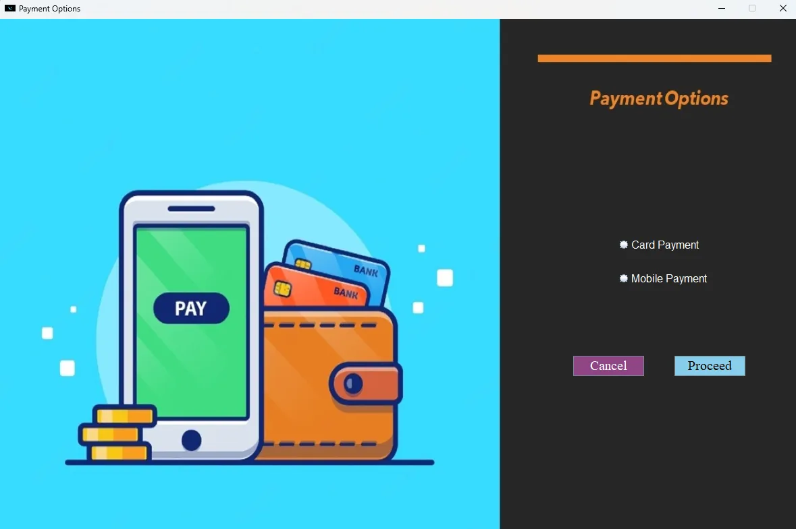<br><sub><b>Payment options (simulated)</b></sub></td>
  </tr>
  <tr>
    <td>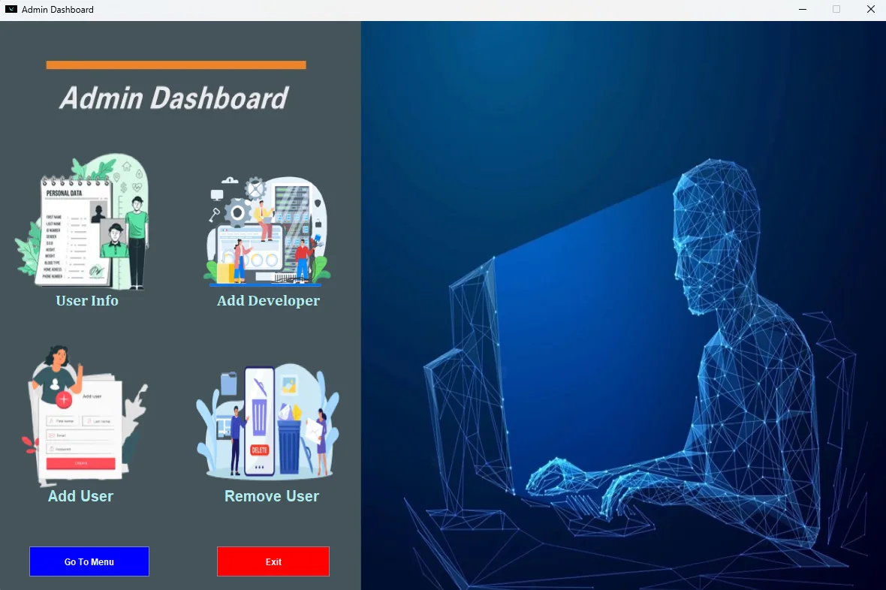<br><sub><b>Admin dashboard</b></sub></td>
    <td>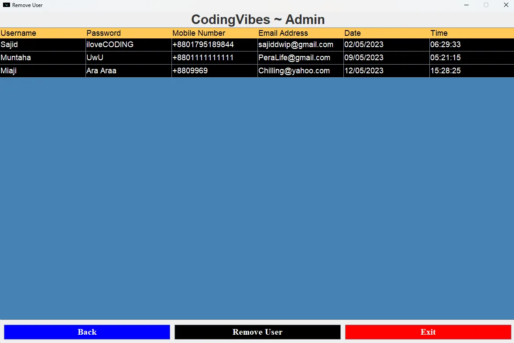<br><sub><b>User management</b></sub></td>
  </tr>
</table>


## ◈ Architecture

Each screen is a `JFrame` in the `SourceFiles` package. Screens open each other directly. The only shared state is a static cart list and the text files under `Data/`.

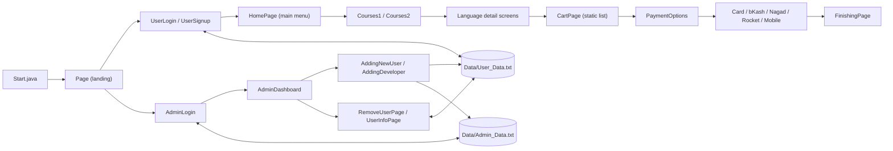


## ◈ Tech Stack

| Layer | Technologies | Purpose |
| --- | --- | --- |
| Language | Java (JDK 17 or later recommended) | Application logic and OOP structure |
| GUI | Swing and AWT | Windows, tables, buttons, event listeners |
| Storage | `java.io` text files | User and admin records under `Data/` |
| Assets | PNG and JPG in `assets/` | Backgrounds, logos and language icons |
| Tooling | Any Java IDE | IntelliJ IDEA, Eclipse or NetBeans |


## ◈ Getting Started

**Prerequisites:** a JDK (17 or later is recommended) and an IDE or the `javac` command line.

```bash
git clone https://github.com/Saji-d/codingvibes-java-gui.git
cd codingvibes-java-gui
```

The screens read images and data files with relative paths, so run from a working directory that contains `assets/` and a `Data/` folder with `User_Data.txt` and `Admin_Data.txt`. The `Data/` folder is not tracked in this repository, so create it and add an admin record before using the admin login. Then open the project in your IDE and run the entry point:

```text
src/main/Start.java   (opens the Page landing screen)
```

> The public class in `Start.java` is declared as `start` in lower case. If your compiler rejects the file name mismatch, rename the class to `Start`.

> Payments, the cart, reviews, contact details and user data are simulations for learning only.


## ◈ Project Structure

<details>
<summary>Show folder tree</summary>

```text
codingvibes-java-gui/
├── assets/            backgrounds, logos, language icons, banner
├── docs/              preview image and README screenshots
├── screenshots/       original full-size screenshots
├── src/
│   ├── interfaces/    login, sign-up and add-user form interfaces
│   └── main/          one class per screen (courses, cart, payments, admin)
├── LICENSE
└── README.md
```

</details>


## ◈ Roadmap

- [x] Admin and user entry, sign-up and login
- [x] Course catalogue, detail pages and in-memory cart
- [x] Simulated payment flow and admin user management
- [ ] Hash passwords instead of storing them as plain text
- [ ] Replace text files with a real database
- [ ] Persist the cart and order history
- [ ] Ship a `Data/` template and a build script so it runs out of the box


## ◈ Author

**Sajidur Rahman Sajid**: Full-Stack Developer and AI engineer from Dhaka. BSc in CSE at American International University-Bangladesh (AIUB).

<p>
  <a href="https://www.sajidur.me"></a>
  <a href="https://www.linkedin.com/in/sajidur-rahman-sajid/"></a>
  <a href="https://github.com/Saji-d"></a>
  <a href="mailto:sajidsajidurrahman99@gmail.com"></a>
</p>

<sub>A learning project, shared as it was built. Released under the MIT licence.</sub>
